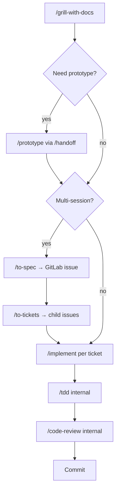

# Agent skills

This repo uses [mattpocock/skills](https://github.com/mattpocock/skills) — composable workflows for planning, triage, implementation, and review. Skills are markdown instructions the agent reads at run time; they are not application code.

## One-time setup

This repo is already configured. New teammates follow [README.md](README.md). Summary of what was done:

### 1. Install skills (every clone)

```bash
npx skills experimental_install
# or: npx skills add mattpocock/skills -y --all
rm -rf agent/skills .claude/skills .cursor/skills
./scripts/remove-global-skill-overlap.sh   # once per machine
```

Do **not** use `--agent cursor` — that creates full copies under `agent/skills/`.

### 2. Configure repo for engineering skills (once per repo — done)

Run `/setup-matt-pocock-skills` **once** when first adopting the skills in this repo. It is **not** required when switching between Cursor, Claude Code, or Antigravity.

It wrote:

| File | Purpose |
|------|---------|
| `AGENTS.md` | Harness entry point — points agents at `docs/agents/` |
| `docs/agents/issue-tracker.md` | GitLab + `glab` conventions |
| `docs/agents/triage-labels.md` | Triage role → label mapping |
| `docs/agents/domain.md` | When to read `GLOSSARY.md` and `docs/adr/` |

Re-run `/setup-matt-pocock-skills` only to change issue tracker, triage labels, or domain layout — **not** when changing coding tools.

### 3. GitLab labels (before first `/triage`)

Create in the GitLab project: `needs-triage`, `needs-info`, `ready-for-agent`, `ready-for-human`, `wontfix`. Auth CLI: `glab auth login`.

## Fresh clone

See the [setup checklist](README.md#quick-start-checklist).

## Canonical layout (one folder)

```
.agents/skills/          ← the only skill folder in this repo (commit this)
skills-lock.json         ← pinned versions (commit this)
```

Cursor, Codex, and Antigravity read `.agents/skills/` directly. Do **not** commit `.claude/skills/`, `.cursor/skills/`, or `agent/skills/` — Cursor prefers the Claude compat path when both exist, which makes pins open `.claude/skills/teach` instead of `.agents/skills/teach`. Those folders are gitignored.

Claude Code users recreate symlinks locally:

```bash
npx skills add mattpocock/skills --agent claude-code -y --all
```

## Project skills vs global skills

Cursor loads skills from both the repo and your home directory. When the same skill name exists in both places, pinning can open the global copy instead of this repo's.

This repo uses **project-local** skills only:

1. Skills live in `.agents/skills/`.
2. Run `./scripts/remove-global-skill-overlap.sh` once per machine to clear global duplicates.

If `/teach` (or any skill) does not appear in the slash menu, check that `.agents/skills/teach/SKILL.md` exists — an empty `.agents/skills/` folder means skills were accidentally removed and need reinstalling.

## How a prompt becomes work

When you send a message in an agent chat, the harness assembles context in layers. It does **not** load the entire repo.

| Layer | Source | Loaded |
|-------|--------|--------|
| System + harness | IDE / CLI | Every turn |
| User rules | Your settings | Every turn |
| Workspace rules | `.cursor/rules`, plugins | Every turn |
| `AGENTS.md` | Repo root | Every turn |
| Skill catalog | `.agents/skills/*/SKILL.md` frontmatter | Every turn (name + description only) |
| Open files + @-mentions | Your editor | Per message |
| Conversation | Chat history | Per thread |
| Full skill body | e.g. `.agents/skills/implement/SKILL.md` | When you type `/implement` or the model invokes it |
| Repo agent config | `docs/agents/*.md` | When tracker/triage/wayfinder skills run |
| Domain docs | `GLOSSARY.md`, `docs/adr/` | When a skill reads them |

Skills are identical across repos. Only `docs/agents/*.md` varies per project. Tracker skills read `docs/agents/issue-tracker.md` at run time and follow whatever it says.

## User-invoked vs model-invoked

| Type | How it runs | Examples |
|------|-------------|----------|
| **User-invoked** | Only when you type `/skill-name` (`disable-model-invocation: true`) | `/grill-with-docs`, `/implement`, `/triage`, `/to-spec` |
| **Model-invoked** | Agent may auto-read when the task matches the description | `/tdd`, `/domain-modeling`, `/research`, `/wizard` |

Use `/ask-matt` when you are unsure which skill fits.

## Main flow: idea → ship

Most feature work follows this path (from the `ask-matt` skill):



**Context hygiene:**

- **One window:** `/grill-with-docs` → `/to-spec` → `/to-tickets` (same thread; do not clear until tickets exist).
- **Fresh window:** each `/implement` reads one GitLab issue; clear context between tickets.
- **Small build:** skip `/to-spec` and `/to-tickets` → `/implement` directly in the same session.

## On-ramps

| Starting situation | Skill | Then |
|--------------------|-------|------|
| Raw issues or MRs piling up | `/triage` | `/implement` when `ready-for-agent` |
| Hard bug or regression | `/diagnosing-bugs` | Fix + regression test |
| Huge foggy effort | `/wayfinder` | `/to-spec` when the map clears |
| Not sure which skill | `/ask-matt` | Routes to the right flow |

## Vocabulary layer (runs underneath)

These are model-invoked references other skills pull in:

- **`/domain-modeling`** — sharpens `GLOSSARY.md` and ADRs.
- **`/codebase-design`** — deep-module design vocabulary.
- **`/grilling`** — interview primitive inside grill, triage, and wayfinder.

## Updating skills

```bash
npx skills update          # update all project skills
npx skills update tdd      # update one skill
```

If a downstream skill behaves differently from your `docs/agents/` files after an upgrade, edit `docs/agents/*.md` by hand or re-run `/setup-matt-pocock-skills` (see [when to run](skills-by-tool.md#setup-matt-pocock-skills--when-to-run)).

## Further reading

- [mattpocock/skills on GitHub](https://github.com/mattpocock/skills)
- [Setup skill reference](https://www.aihero.dev/skills-setup-matt-pocock-skills)
- [Using skills with specific coding tools](skills-by-tool.md)
